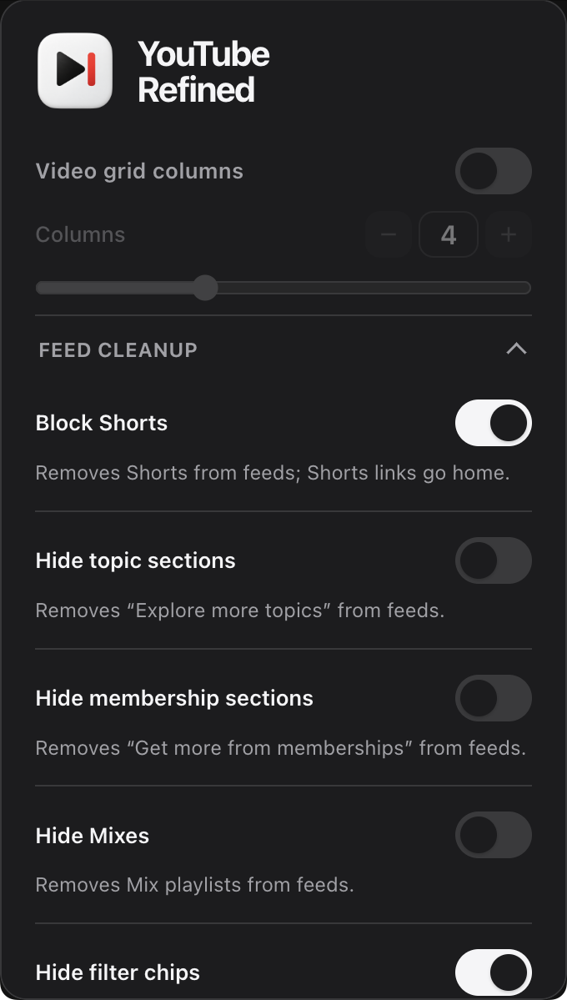

# YouTube Refined

A lightweight, distraction-free Chrome extension to declutter YouTube. Customize your video grid layout, block Shorts, clean up the navigation bar, and hide unwanted feed shelves — with zero tab reloads and no tracking.

---

## Preview

<p align="left">
  
</p>

---

## Features

- **Custom Video Grid:** Set 1 to 10 video columns per row with a slider. Automatically adapts to fit smaller windows.
- **Navbar Controls:** Hide the Create button, Voice Search, Notification bell, or Country Code badge. Adds an optional one-click Settings shortcut next to your profile.
- **Mini-Sidebar Toggle:** Hides the collapsed left navigation strip for edge-to-edge feeds while keeping the hamburger menu functional.
- **Block Shorts:** Removes Shorts shelves, chips, and grid cards. Automatically redirects Shorts URLs to the home feed.
- **Feed Cleanup:** Hide "Explore more topics", channel membership promos, auto-generated Mixes, and top filter chips.
- **Feed Filters:** Filter out live streams, playlists, or already-watched videos.
- **Watch Page:** Hide comments, the recommendation sidebar, or end-screen cards for distraction-free viewing.

---

## Key Details

- **Instant Updates:** Settings apply immediately to all open tabs via `chrome.storage.onChanged`. No page reload required.
- **Flicker-Free:** Core styles inject at `document_start` to prevent layout flashes.
- **Private & Lightweight:** Vanilla JavaScript with zero external dependencies, trackers, or telemetry.

---

## Installation

1. Clone or download this repository:
   ```bash
   git clone https://github.com/bugtoast/YouTube-Refined.git
   ```
2. Open Chrome and go to `chrome://extensions`.
3. Enable **Developer mode** (top-right toggle).
4. Click **Load unpacked** and select the `ext` folder (or `dist/youtube-refined` after building).
5. Pin **YouTube Refined** from the extensions toolbar.

---

## Building

To build a fresh distribution folder and release `.zip`:

```bash
bash tools/build.sh
```

Outputs are created in `dist/`.

---

## Privacy & License

- **100% Local:** No analytics, tracking, or network calls. Preferences stay in your browser.
- Licensed under the [MIT License](LICENSE).